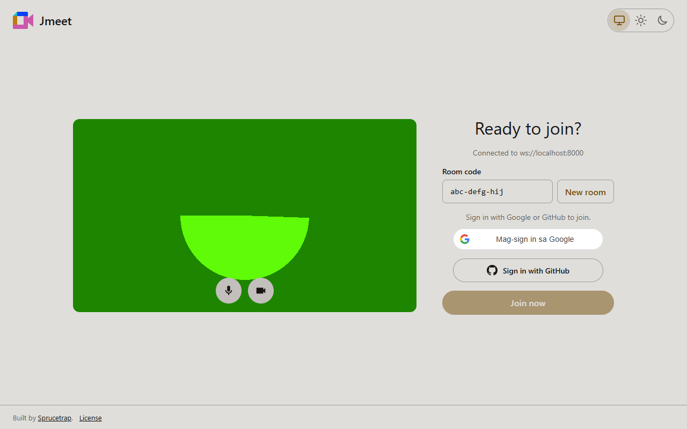
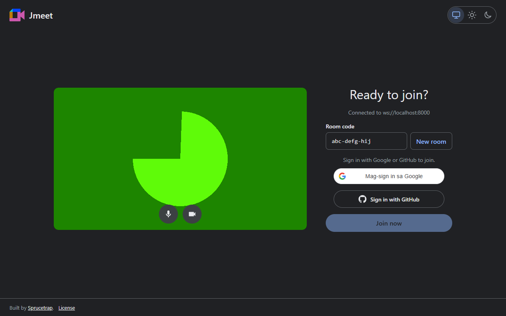
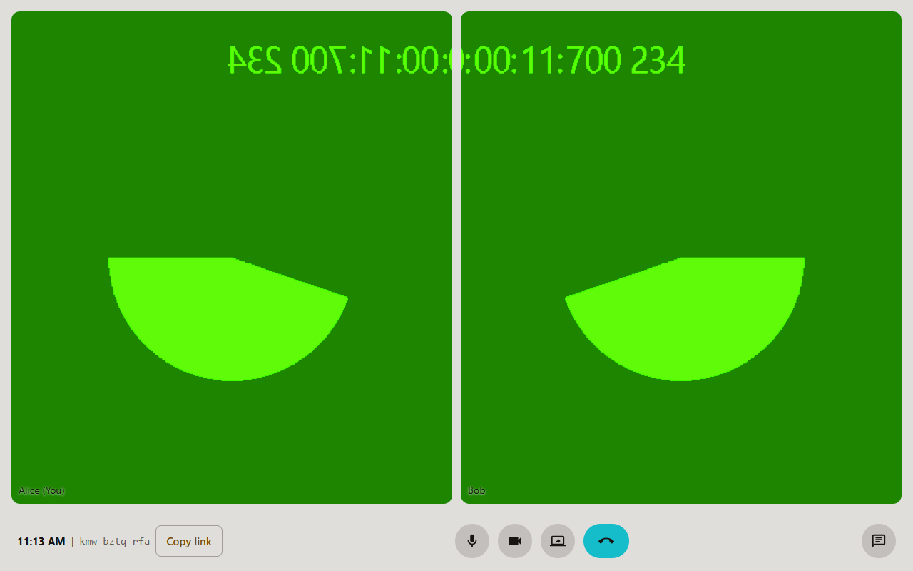
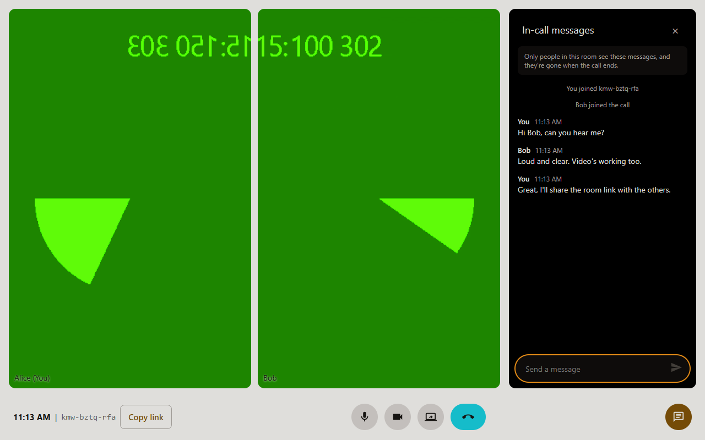
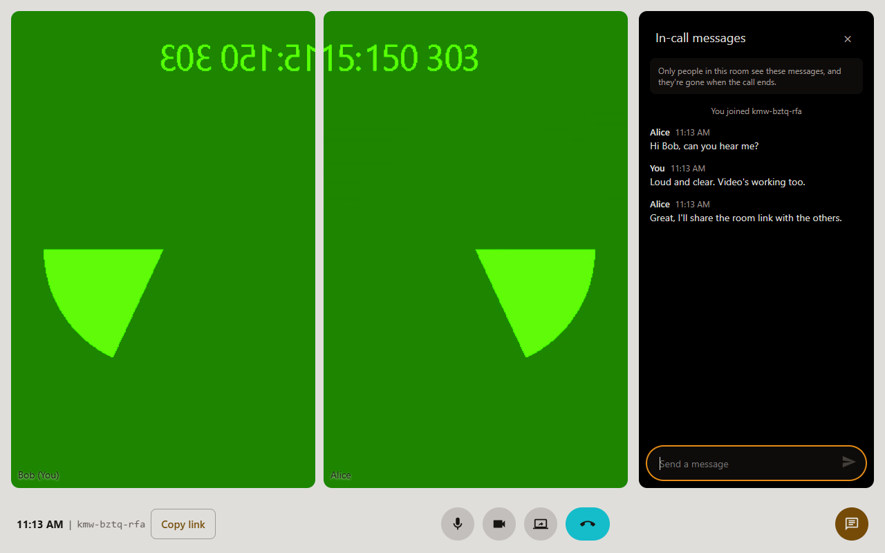
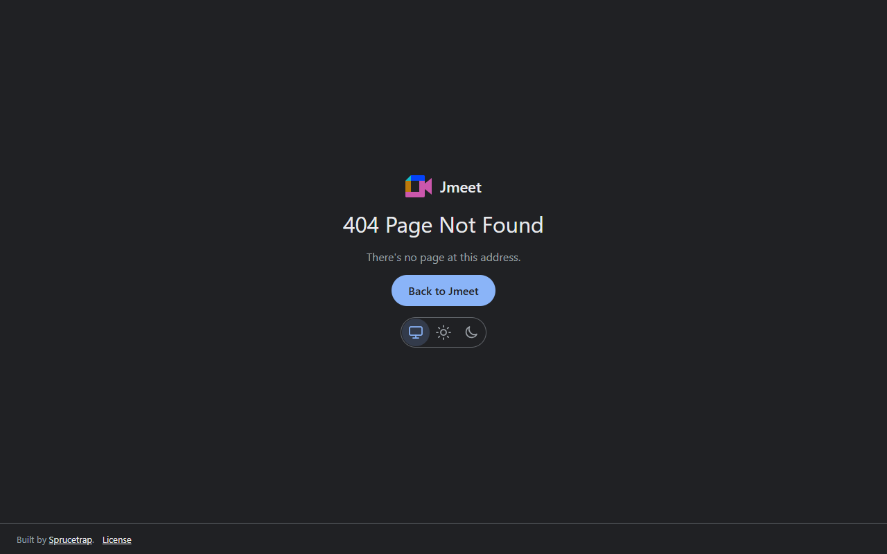
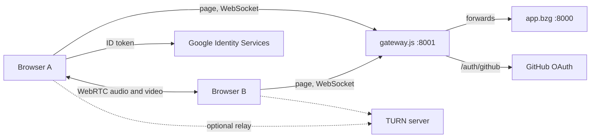

<a id="top"></a>

<div align="center">


# Jmeet

Sign in with Google or GitHub, make a room, and share the link for a group video call.

[](https://github.com/Jevoel16/ITE183_Lab3_Google-OAuth-and-WebRTC--videocall-/actions/workflows/ci.yml)


</div>



<p align="center">
  <a href="#about">About</a> · <a href="#screenshots">Screenshots</a> · <a href="#features">Features</a> · <a href="#tech-stack">Tech Stack</a> · <a href="#architecture">Architecture</a> · <a href="#getting-started">Getting Started</a> · <a href="#configuration">Configuration</a> · <a href="#usage">Usage</a> · <a href="#more">More</a>
</p>

---

## About

Jmeet is a Google Meet-style video call I built for ITE183 Laboratory 3. It adds Google and GitHub sign-in and WebRTC rooms to my Laboratory 2 WebSocket chat server, which runs on Bonezegei. Audio and video go straight between browsers; the server only passes signaling and chat between people in the same room.

## Screenshots

<details>
<summary><b>Screenshots</b></summary>

<table>
  <tr>
    <td width="50%" align="center"><b>Join screen (Light)</b><br><a href="docs/images/hero.png"></a></td>
    <td width="50%" align="center"><b>Join screen (Dark)</b><br><a href="docs/images/join-dark.png"></a></td>
  </tr>
  <tr>
    <td width="50%" align="center"><b>In a call</b><br><a href="docs/images/in-call.png"></a></td>
    <td width="50%" align="center"><b>Chat (Alice)</b><br><a href="docs/images/chat.png"></a></td>
  </tr>
  <tr>
    <td width="50%" align="center"><b>Chat (Bob)</b><br><a href="docs/images/chat-bob.png"></a></td>
    <td width="50%" align="center"><b>404 page</b><br><a href="docs/images/not-found.png"></a></td>
  </tr>
</table>

</details>

## Features

- Sign in with Google or GitHub; the sign-in lasts until it expires, even after a refresh
- Meet-style room codes like `abc-defg-hij`, with a link that opens the join screen with the code filled in
- Group video grid with mic, camera, screen sharing and profile photos when the camera is off
- Join muted or with the camera off from the join screen
- In-call chat with an unread badge and pop-up notifications
- Reconnects and rejoins the room on its own after a dropped connection
- Works across networks through a Cloudflare tunnel, with an optional TURN relay
- System, Light and Dark themes

## Tech Stack

| Layer | Tools |
|---|---|
| Server | Bonezegei 1.3.3, `http` module 1.0.1 (HTTP and WebSocket) |
| Gateway and tests | Node.js 26.13.1 (built-ins only), `node:test` |
| Sign-in | Google Identity Services, GitHub OAuth web flow |
| Media | WebRTC with Google's public STUN server, plus TURN if set |
| Client | HTML, CSS and plain JavaScript, no build step |

## Architecture



The gateway exists because Bonezegei can't call GitHub over HTTPS or accept cloudflared's WebSocket header. Sign-in checks, rooms, routes and the message protocol are in [docs/architecture.md](docs/architecture.md).

## Getting Started

You need Windows, Bonezegei 1.3.3 from the Microsoft Store, Node.js 26 and a Google OAuth client ID ([how to get one](docs/setup.md#google-oauth-client-id)).

```bash
git clone https://github.com/Jevoel16/ITE183_Lab3_Google-OAuth-and-WebRTC--videocall-.git
cd ITE183_Lab3_Google-OAuth-and-WebRTC--videocall-
bzg install
# copy the Local block of .env.example into .env and set GOOGLE_CLIENT_ID
npm run dev
```

Open <http://localhost:8001>. `npm run dev` writes `public/config.js` from `.env`, then starts Bonezegei on 8000 and the gateway on 8001. Ctrl+C stops both.

## Configuration

Every key goes in `.env`; [`.env.example`](.env.example) lists them with placeholders. Only the Google client ID is required. The GitHub app, TURN server and ports are explained in [docs/setup.md](docs/setup.md).

<details>
<summary><b>Environment variables</b></summary>

| Key | Used by |
|---|---|
| `GOOGLE_CLIENT_ID` | Browser (Google button) |
| `GOOGLE_CLIENT_SECRET` | Nothing yet; the Google popup doesn't need it |
| `GITHUB_CLIENT_ID` | Gateway; also shows the GitHub button |
| `GITHUB_CLIENT_SECRET` | Gateway only, never sent to the browser |
| `TURN_URLS` | Browser, comma-separated TURN URLs |
| `TURN_USERNAME` / `TURN_CREDENTIAL` | Browser (TURN relay) |

</details>

## Usage

1. Open <http://localhost:8001> and click New room, or paste a code you were given.
2. Sign in with Google (popup) or GitHub (redirect, then back to the same room).
3. Turn the mic or camera off if you like, then click Join now.
4. Click Copy link in the call bar and send it. People in other rooms never see this call or its chat.

To let people on other networks join, run `npm run share` and send the `trycloudflare.com` address it prints. Add that address to your Google client's origins first ([details](docs/setup.md#share-it-online)). If something goes wrong, see [docs/troubleshooting.md](docs/troubleshooting.md).

## More

<details>
<summary><b>Project structure</b></summary>

```
app.bzg       Bonezegei server: HTTP routes and the per-room WebSocket relay
public/       Client: index.html, jmeet-core.js (tested logic), style.css, 404.html, config.example.js
scripts/      Gateway, GitHub sign-in, config writer, launcher, syntax check and their tests
lib/          Bonezegei http module (http.dll)
docs/         Setup, architecture, state machines, testing, troubleshooting, images
```

</details>

<details>
<summary><b>Scripts</b></summary>

| Command | What it does |
|---|---|
| `bzg install` | Installs the `http` module listed in `package.json` |
| `npm run dev` | Writes `config.js`, then starts Bonezegei (8000) and the gateway (8001) |
| `npm run share` | Same as `dev`, plus a Cloudflare quick tunnel |
| `npm run tunnel` | Only the tunnel, when the app is already running |
| `npm start` | Only Bonezegei on 8000 (enough for Google sign-in) |
| `npm run gateway` | Only the gateway on 8001 |
| `npm run config` | Writes `public/config.js` from `.env` |
| `npm test` | Syntax checks and the `node:test` suites ([what they cover](docs/testing.md)) |

</details>

<p align="right"><a href="#top">Back to top</a></p>
