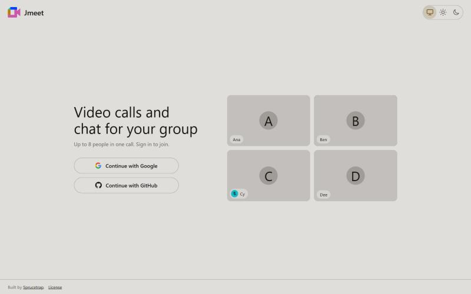
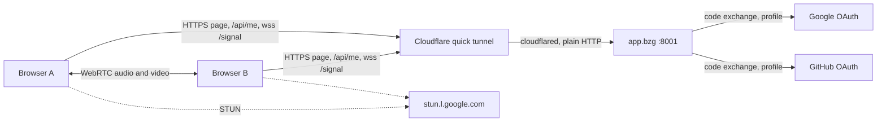

<a id="top"></a>

<div align="center">


# Jmeet

Group video calls with chat in Meet-style rooms (up to 8 people), signed in with Google or GitHub, on a Bonezegei server.

[](https://github.com/Jevoel16/ITE183_Lab3_Google-OAuth-and-WebRTC--videocall-/actions/workflows/ci.yml)


</div>

<p align="center">
  <a href="#about">About</a> · <a href="#group-members">Group Members</a> · <a href="#setup">Setup</a> · <a href="#ui-redesign">UI Redesign</a> · <a href="#backend-changes">Backend Changes</a> · <a href="#terminal-output">Terminal Output</a> · <a href="#screenshots">Screenshots</a> · <a href="#architecture">Architecture</a>
</p>

---

## About

ITE183 Laboratory 3. Jmeet starts from the class starter repo [msuiit-ph/BSL_OAuth_and_WebRTC](https://github.com/msuiit-ph/BSL_OAuth_and_WebRTC): `app.bzg` signs people in with Google or GitHub (OAuth 2.0 authorization code flow), keeps the session in an `HttpOnly` cookie, serves the page and relays WebRTC signaling and chat over `/signal`. Audio and video go straight between browsers.

By default the app runs behind a Cloudflare quick tunnel: `app.bzg` listens on plain HTTP at `localhost:8001` and Cloudflare gives everyone an HTTPS `trycloudflare.com` address, so teammates can join from anywhere and both Google and GitHub sign-in work. Local HTTPS on port 443 with a self-signed certificate is still there as a fallback (`useTunnel = 0`).

On top of the starter we redesigned the whole client in the Jmeet look (Google Meet's palette, inverted for the Light theme), added an active-speaker ring, muted badges, screen sharing, a chat drawer, Meet-style rooms with invite links, and a heartbeat with automatic reconnect.

## Group Members

| Member | GitHub | Contributions |
|---|---|---|
| _Name_ | [@Jevoel16](https://github.com/Jevoel16) | _Server setup, client redesign, README_ |
| _Name_ | _@username_ | _What they did_ |
| _Name_ | _@username_ | _What they did_ |

## Setup

You need Windows, Bonezegei Scripting Language **v1.3.4** (Microsoft Store), [cloudflared](https://developers.cloudflare.com/cloudflare-one/connections/connect-networks/downloads/) and a Google and a GitHub OAuth app. OpenSSL (comes with Git for Windows) is only needed for the local HTTPS fallback. Full steps, including the OAuth consoles, are in [docs/setup.md](docs/setup.md).

```bash
git clone https://github.com/Jevoel16/ITE183_Lab3_Google-OAuth-and-WebRTC--videocall-.git
cd ITE183_Lab3_Google-OAuth-and-WebRTC--videocall-
bzg install

# keys: copy the template, then fill in your own (config.bzg is gitignored)
cp config.example.bzg config.bzg

# online: Cloudflare quick tunnel, prints and copies https://<random>.trycloudflare.com
npm run online

# or local: https://localhost with a self-signed certificate in cert/
npm run local
```

`npm run online` writes the tunnel address into `config.bzg` and prints the two callbacks to add to the Google and GitHub apps. A quick tunnel gets a new address every time it starts, so add them each session. Ctrl+C stops the app and the tunnel together (see [docs/setup.md](docs/setup.md#3-run-behind-a-cloudflare-quick-tunnel)). For local HTTPS without a tunnel, see [Local HTTPS fallback](docs/setup.md#local-https-fallback).

`config.bzg`, `cert/`, `*.pem` and `*.key` are in [.gitignore](.gitignore), which was committed before any key or certificate existed, so none are in the history.

## UI Redesign

Everything is in [public/index.html](public/index.html), [public/style.css](public/style.css) and [public/jmeet-core.js](public/jmeet-core.js). The starter's element ids (`#login`, `#app`, `#videos`, `#local`, `#join`, `#leave`, `#video-toggle`, `#audio-toggle`, `#chat-log`, `#chat-form`, `#chat-input`, `#chat-send`, `#identity`, `#status`, `#logout`, `#session-status`, `#error`) are all kept.

**Login view.** A split layout: the sign-in card on the left, and on the right a still of the call grid built from the same tile styles the call uses. While `/api/me` is pending, `#session-status` shows the logo and "Checking your session...". If the check fails, `#error` turns into a banner with a Try again button.

**Rooms.** The header shows the room code (`abc-defg-hij`), which is also the URL hash, and a button that copies the invite link. Opening the site without a code makes a new room. Before joining you can type a code or paste a link; in the call the code is locked.

**Call view.** The header holds the logo, the room code, the call status (`3 in the call`), the signed-in user's avatar and name, the theme picker and Log out. The grid sizes itself from the number of tiles:

```js
// 1 tile, 2x2 up to 4, then 3 wide (8 people = 3+3+2)
function gridColumns(n) {
    return n <= 1 ? 1 : n <= 4 ? 2 : 3;
}
```

Each tile has a name badge, a red mic-off badge, and the profile photo or initial when the camera is off. The loudest tile gets an accent ring, measured with a Web Audio analyser per stream:

```js
meters.forEach((m, tile) => {
    m.analyser.getByteTimeDomainData(m.data);
    let max = 0;
    for (const v of m.data) max = Math.max(max, Math.abs(v - 128));
    if (max > peak && !tile.classList.contains("audio-off")) { peak = max; loudest = tile; }
});
```

**Control bar.** Round mic and camera buttons turn red when off, Present shares the screen in place of the camera, Join call becomes a red Leave button once in the call.

**Chat.** A side panel on desktop and a full-screen drawer on phones. Your messages are accent bubbles on the right, others are grey bubbles on the left with their avatar. A dot on the chat button and a toast show new messages while the panel is closed.

Sign-in and the call each run on one state machine in `jmeet-core.js`, listed in [docs/state-machines.md](docs/state-machines.md).

## Backend Changes

`app.bzg` is the starter's file with four additions:

1. It serves `/style.css`, `/jmeet-core.js`, and `public/404.html` for unknown paths.
2. A `media` message relays mic and camera state to everyone else. BSL's `parseJSON` turns `true` into a number, so the state travels as `1` or `0`:

```js
} else if (kind == "media") {
    var audio = profileField(incoming, "audio");
    var video = profileField(incoming, "video");
    if (audio.type == "number" && video.type == "number" && (audio == 0 || audio == 1) && (video == 0 || video == 1)) {
        var update = stringifyJSON({kind: "media", from: clientId, audio: audio, video: video});
        // sent to every other participant
```

3. Rooms. A socket has to send `{kind: "join", room}` first, and every relay loop goes through `sendToRoom()`. BSL's `regex` has no character classes, so the code is checked by hand:

```js
function isRoomCode(room) {
    if (room.type != "string" || room.size != 12) {
        return false;
    }
    for (var i = 0; i < 12; i = i + 1) {
        var ch = substr(room, i, 1);
        if (i == 3 || i == 8) {
            if (ch != "-") {
                return false;
            }
        } else if (!isLetter(ch)) {
            return false;
        }
    }
    return true;
}
```

4. None on the server for big offers: the browser splits any signal over 3000 characters into numbered `chunk` parts and joins them back, because the native `http.dll` has failed on large WebSocket frames before.

## Terminal Output

<!-- Paste your own output here after updating to v1.3.4 -->

```text
> bonezegei --version
Bonezegei Script Interpreter v1.3.4

> bzg install
Reading dependencies from package.json...
 Installed  'http' for arch=x86

> bzg run
Listening on http://localhost:8001 for cloudflared
Open https://<random>.trycloudflare.com
```

## Screenshots

<!-- Add the images to docs/images/ with these names -->

| Login | Signed in with Google | Signed in with GitHub |
|---|---|---|
|  |  |  |

| Whole group in the call, with chat |
|---|
|  |

## Architecture



Routes, messages and the sign-in flow are in [docs/architecture.md](docs/architecture.md). Tests: [docs/testing.md](docs/testing.md). Problems: [docs/troubleshooting.md](docs/troubleshooting.md).

<p align="right"><a href="#top">Back to top</a></p>
