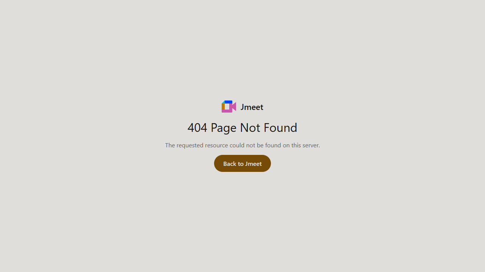

<a id="top"></a>

<div align="center">


# Jmeet: Google/GitHub OAuth + WebRTC Video Call

**ITE183 – Web Systems and Technologies | Laboratory 3: Google OAuth and WebRTC (Video Call)**

*Sign in with Google or GitHub, make a room, and share the link for a multi-person video call on a Bonezegei WebSocket server.*


[](https://github.com/Jevoel16/ITE183_Lab3_Google-OAuth-and-WebRTC--videocall-/actions/workflows/ci.yml)

</div>

---

## Table of Contents

- [Description](#description)
- [Features](#features)
- [Tech Stack](#tech-stack)
- [Prerequisites](#prerequisites)
- [Installation](#installation)
- [Configuration](#configuration)
- [Usage](#usage)
- [How It Works](#how-it-works)
- [Project Structure](#project-structure)
- [Scripts](#scripts)
- [Testing](#testing)
- [Troubleshooting](#troubleshooting)
- [Contributing](#contributing)
- [License](#license)
- [Author](#author)

---

## Description

Jmeet is a browser-based meeting room in the style of Google Meet. Laboratory 3 builds on the Laboratory 2 WebSocket server and adds:

1. **Google or GitHub sign-in.** Participants sign in with Google (OAuth 2.0 / OpenID Connect through Google Identity Services) or GitHub (OAuth web flow through a small Node gateway) before they can join. Their name and profile photo are used in the call.
2. **WebRTC video calling in rooms.** Each call has a Meet-style code like `abc-defg-hij`, and the link carries it. Audio and video go peer-to-peer between browsers. The Bonezegei server (`app.bzg`) only relays signaling (offer / answer / ICE) and chat over WebSocket, and only to people in the same room.

The app runs locally at `http://localhost:8001`. To let people on other networks join, share it through a Cloudflare quick tunnel (see [Share it online](#share-it-online)).

<p align="right"><a href="#top">back to top</a></p>

---

## Features

- **Sign in with Google or GitHub**: the official Google button, a matching GitHub button, a signed-in user chip (photo, name, email) and **Sign out**
- **Rooms**: **New room** makes a code like `abc-defg-hij`; the link (`http://localhost:8001/#abc-defg-hij`) opens the join screen with the code filled in, and **Copy link** in the call bar copies it
- **Stays connected**: a heartbeat every 25 s keeps idle calls open through Cloudflare, and if the connection drops the page reconnects (1, 2, 4, 8, then every 15 s) and re-joins the room
- **Calls across networks**: optional TURN relay servers in `config.js`, one ICE restart before giving up on a peer, and a **Tap to hear the call** button when a phone blocks audio
- **System, Light and Dark themes**: Light is Google Meet's palette inverted; Dark is the original Meet palette with the inverted logo kept
- **ID token checks**: audience, issuer, expiry and verified email are checked before sign-in is accepted
- **Session kept on refresh** (per browser tab) until the sign-in expires (Google: about 1 hour, GitHub: 8 hours)
- **Join is locked** until the user is signed in *and* connected to the server
- **Multi-person video grid** (mesh WebRTC) with names and profile photos when the camera is off
- **Pre-join mic and camera toggles**: turn the microphone or camera off on the join screen, and the call starts that way
- **Call controls**: microphone, camera, screen sharing and Leave
- **Real-time chat** with names, timestamps, unread badge and pop-up notifications
- **Custom 404 page** and server console logging of HTTP requests and WebSocket events
- **Message chunking** that keeps large WebRTC payloads under the native module's frame-size limit

<p align="right"><a href="#top">back to top</a></p>

---

## Tech Stack

| Layer | Technology | Version |
|---|---|---|
| Server runtime | Bonezegei Scripting Language | 1.3.3 |
| HTTP / WebSocket | Bonezegei `http` native module (`lib/http/http.dll`) | 1.0.1 |
| Authentication | Google Identity Services (`https://accounts.google.com/gsi/client`) | Google-hosted |
| Authentication | GitHub OAuth web flow, served by `scripts/gateway.js` (Node built-ins only) | Node.js 26 LTS |
| Media | WebRTC (`RTCPeerConnection`) with Google's public STUN server, plus your TURN server if set | Browser-native |
| Client | HTML, CSS, vanilla JavaScript (no build step, no npm packages) | – |
| Tests | `node:test` | Node.js 26 LTS |

<p align="right"><a href="#top">back to top</a></p>

---

## Prerequisites

| Requirement | Details |
|---|---|
| Operating system | Windows (64-bit) |
| Runtime | **Bonezegei v1.3.3**, with `bonezegei` and `bzg` on your `PATH` (default: `C:\Program Files\Bonezegei`) |
| Google account | To create the OAuth client and to sign in |
| Google Cloud project | Free; used only for the OAuth client ID |
| Browser | Chrome, Edge or Firefox, with a camera and microphone for video |
| Internet | Needed to load Google's sign-in script and to sign in |
| Node.js 26 | Runs the gateway on port 8001 (`scripts/gateway.js`), `npm run config` and `npm test`. Pinned in `.nvmrc` |
| GitHub account (optional) | To create the GitHub OAuth app and to sign in with GitHub |
| cloudflared (optional) | To share the app online: `winget install Cloudflare.cloudflared` |

Install Bonezegei on Windows from the **Microsoft Store** (uninstall older versions first). Then check the version:

```bash
bonezegei -v
```

<p align="right"><a href="#top">back to top</a></p>

---

## Installation

1. **Clone the repository**

   ```bash
   git clone https://github.com/Jevoel16/ITE183_Lab3_Google-OAuth-and-WebRTC.git
   ```

2. **Install dependencies** (from the project root)

   ```bash
   bzg install
   ```

3. **Create your `.env`**: copy the Local block of `.env.example` into a new `.env` and fill in your Google client ID, and optionally your GitHub OAuth app and TURN server (see [Configuration](#configuration)). Keys left as `YOUR_...` are skipped.

4. **Write the browser config** from `.env`

   ```bash
   npm run config
   ```

   This creates `public/config.js`. Without Node.js, copy `public/config.example.js` to `public/config.js` and fill it in by hand instead.

<p align="right"><a href="#top">back to top</a></p>

---

## Configuration

Every key lives in `.env`, in one of the three blocks of `.env.example`:

| Key | Example | Used by |
|---|---|---|
| `GOOGLE_CLIENT_ID` | `123456789-abc123.apps.googleusercontent.com` | Browser (Google button) |
| `GOOGLE_CLIENT_SECRET` | (secret) | Nothing yet. Kept for a server-side Google flow; the popup doesn't need it |
| `GITHUB_CLIENT_ID` | `Ov23li...` | Gateway; also turns on the GitHub button |
| `GITHUB_CLIENT_SECRET` | (secret) | Gateway only, never sent to the browser |
| `APP_URL` | `http://localhost:8001` | Gateway: where to send people back after GitHub sign-in |
| `GITHUB_CALLBACK_URL` | `http://localhost:8001/auth/github/callback` | Gateway; must match the callback URL on GitHub |
| `TURN_URLS` | `turn:relay.example:3478,turns:relay.example:443?transport=tcp` | Browser (TURN relay), comma-separated |
| `TURN_USERNAME` / `TURN_CREDENTIAL` | (from your TURN provider) | Browser (TURN relay) |

Google sign-in needs no client secret. The Sign in with Google popup hands the browser a signed ID token, so only the client ID is used. A secret is only needed for Google's server-side code flow, which this app doesn't use.

The browser can't read `.env`, so `npm run config` writes `public/config.js` from it. `npm run dev` and `npm run share` do this for you on every start. Never put a client secret in `config.js` by hand: the server sends that file to every visitor at `/config.js`, and the generated one only ever holds the client ID, the GitHub sign-in URL and the TURN details. Run it again after you change `.env`. It refuses to write when neither Google nor GitHub is set, so an existing `config.js` is never wiped. The generated file looks like this:

```js
window.JMEET_CONFIG = {
    googleClientId: "123456789-abc123.apps.googleusercontent.com",
    githubAuthUrl: "http://localhost:8001/auth/github",   // "" hides the GitHub button
    iceServers: [
        { urls: "turn:YOUR_TURN_HOST:3478", username: "YOUR_USERNAME", credential: "YOUR_PASSWORD" }
    ]
};
```

| File | Committed? | Purpose |
|---|---|---|
| `.env.example` | Yes | Placeholder keys in Local, Development and Production blocks |
| `.env` | No (gitignored) | All your keys |
| `public/config.js` | No (gitignored) | Written by `npm run config` from `.env` |
| `public/config.example.js` | Yes | Shape of `config.js`, for filling in by hand without Node.js |

The Google client ID and TURN details are sent to every browser anyway. The client secrets stay in `.env`; only the gateway reads `GITHUB_CLIENT_SECRET`, and nothing reads `GOOGLE_CLIENT_SECRET` yet.

### Ports

You open one port: **8001**, locally and through the tunnel.

| Port | Program | Use |
|---|---|---|
| 8001 | `scripts/gateway.js` | The address you open. Serves `/auth/github` itself and forwards everything else (page, files, WebSocket) to 8000 |
| 8000 | `app.bzg` | The Bonezegei server behind the gateway |

For local use with Google sign-in only, 8000 alone is enough: run `npm start` and open `http://localhost:8000`. Rooms, calls and chat all work. You need the gateway only for GitHub sign-in or the tunnel.

Bonezegei can't make the HTTPS call GitHub needs, and its `http.dll` rejects the WebSocket header as cloudflared spells it (`Sec-Websocket-Key`), so the gateway sits in front and handles both.

### Creating the Google OAuth client ID

1. Open the [Google Cloud Console](https://console.cloud.google.com/) and create (or pick) a project.
2. Go to **APIs & Services → OAuth consent screen** (Google Auth Platform → Branding / Audience):
   - User type: **External**
   - App name: `Jmeet`, plus your support and developer email
   - App logo (optional): upload [`screenshots/oauth-logo-120.png`](screenshots/oauth-logo-120.png) (120×120 PNG, under 1 MB, as Google requires). A 512×512 copy, [`screenshots/oauth-logo-512.png`](screenshots/oauth-logo-512.png), is there if you need a larger version. Adding a logo makes Google ask for brand verification before it is shown to users outside your test list; skip it if you don't need it.
   - Publishing status: leave it in **Testing**, and add every Google account that will sign in under **Test users**
3. Go to **APIs & Services → Credentials → Create credentials → OAuth client ID**:
   - Application type: **Web application**
   - **Authorized JavaScript origins**: add
     - `http://localhost:8001` (the gateway, the one you open)
     - `http://localhost:8000`
     - `http://localhost`
     - your tunnel URL, if you share the app online (see [Share it online](#share-it-online))
   - Authorized redirect URIs: leave empty (the popup flow doesn't use one)
4. Put the **Client ID** in `GOOGLE_CLIENT_ID` in `.env` and run `npm run config`.

> New origins can take a few minutes to start working.

### Creating the GitHub OAuth app

1. Open GitHub **Settings → Developer settings → OAuth Apps → New OAuth App**.
2. Homepage URL: `http://localhost:8001`. Authorization callback URL: `http://localhost:8001/auth/github/callback`.
3. Copy the **Client ID**, click **Generate a new client secret**, and put both in `.env`.
4. Run `npm run config` (to show the GitHub button) and restart `bzg run` so the gateway picks up the keys.

GitHub allows one callback URL per OAuth app, and quick-tunnel addresses change on every run, so GitHub sign-in works on localhost only for now. The tunnel already points at the gateway, so with a fixed tunnel hostname you only fill in the Development block of `.env.example` and register that hostname's callback URL on GitHub.

### Adding a TURN server

STUN lets two browsers find a direct path. Between very different networks (mobile data and home Wi-Fi) that path often fails, or carries audio in one direction only. A TURN server relays the media instead. Free options include Metered's Open Relay and Cloudflare's TURN service; create an account, put the TURN URLs, username and credential in `TURN_URLS`, `TURN_USERNAME` and `TURN_CREDENTIAL` in `.env`, run `npm run config`, and reload.

<p align="right"><a href="#top">back to top</a></p>

---

## Usage

### Start the app

```bash
npm run dev
```

This refreshes `public/config.js` from `.env`, starts Bonezegei (8000) and the gateway (8001) in one terminal with each line labelled `[app]` or `[gateway]`, and prints `Open http://localhost:8001`. Ctrl+C stops both. Without GitHub keys in `.env`, only GitHub sign-in is off.

`bzg run` still works too. It starts every script in `package.json` at once (`start`, `gateway`, `config` and `test`); `dev`, `share` and `tunnel` notice they were started by `bzg` and skip themselves, so `bzg run` never opens a public tunnel.

Expected output:

```
HTTP server listening on port 8000 (High Concurrency Thread-Pool Active)
```

### Participant flow

1. Open <http://localhost:8001>. The join screen shows the camera preview and `Connected to ws://localhost:8001`.
2. Click **New room** for a fresh code, or type or paste one you were given.
3. Click **Sign in with Google** (popup) or **Sign in with GitHub** (redirect, then back to the same room).
4. Your photo, name and email appear in the user chip, and **Join now** becomes active.
   Optionally use the microphone and camera buttons under the preview to join muted or with the camera off (they turn red, and the preview shows "Camera is off").
5. Click **Join now**. The address bar now ends in `#<room code>`, and your tile shows your name with "(You)".
6. Click **Copy link** in the call bar and send it. Whoever opens it lands on the join screen with the code filled in. People in other rooms never see this call or its chat.
7. Use the controls to mute, turn off the camera (your photo is shown instead), present your screen, chat, or **Leave**. **Rejoin** returns to the same room.
8. Click **Sign out** on the join screen to switch accounts.

### Share it online

A Cloudflare quick tunnel gives the app a public `https://….trycloudflare.com` address with a valid certificate. It's free and needs no account. The app stays on your PC, so it's only online while `bzg run` and the tunnel are running.

```bash
npm run share
```

This starts everything `npm run dev` does plus a Cloudflare quick tunnel to port 8001, and prints `Share this address: https://….trycloudflare.com` once cloudflared has one. If the app is already running from `npm run dev`, open a second terminal and use `npm run tunnel` for the tunnel alone.

Under the hood the tunnel runs `cloudflared tunnel --config NUL --url http://localhost:8001`. `--config NUL` stops cloudflared from loading `%USERPROFILE%\.cloudflared\config.yml`. A named tunnel's config there has a catch-all rule that answers every quick tunnel address with an empty 404. The "Configuration file NUL was empty" line it prints is harmless.

1. Copy the `https://….trycloudflare.com` address that `npm run share` prints. It can take up to a minute to start working.
2. Add that address to the client's **Authorized JavaScript origins** (see [Creating the Google OAuth client ID](#creating-the-google-oauth-client-id)) and wait a few minutes.
3. Share the address. Everyone who signs in must be a test user while the app is in Testing mode.

The tunnel points at the gateway on port 8001, the same address you use locally. cloudflared sends the WebSocket header as `Sec-Websocket-Key`, and Bonezegei's `http.dll` only accepts `Sec-WebSocket-Key`, so pointed straight at 8000 the page loads but never connects. The gateway fixes the header's capitalization and passes the WebSocket through unchanged.

The address changes every time you start cloudflared, so you add the new one to Google each time. For people on very different networks (mobile data and home Wi-Fi, for example), add a TURN server (see [Adding a TURN server](#adding-a-turn-server)); with STUN only, video may not connect or audio may only go one way. Cloudflare closes a WebSocket after about 100 seconds with no traffic, so the page pings the server every 25 seconds.

### Screenshots

| Screen | File |
|---|---|
| Join screen with the Google button | `screenshots/google-signin.png` *(to capture)* |
| Signed-in join screen (user chip) | `screenshots/signed-in.png` *(to capture)* |
| Two signed-in users in a call | `screenshots/video-call.png` *(to capture)* |
| Server log | `screenshots/terminal-install-run.png` |
| Custom 404 page | `screenshots/404-page.png` |



<p align="right"><a href="#top">back to top</a></p>

---

## How It Works

```
 ┌───────────────┐  1. Sign in (popup)   ┌────────────────────────┐
 │   Browser A   │ ────────────────────► │ Google Identity        │
 │               │ ◄──────────────────── │ Services (OAuth 2.0)   │
 │               │  2. ID token (JWT)    └────────────────────────┘
 │               │
 │               │  1b. Sign in (redirect) ┌──────────────────┐   ┌────────┐
 │               │ ──────────────────────► │ gateway.js       │ ─►│ GitHub │
 │               │ ◄────── #auth=profile ─ │ :8001            │ ◄─│ OAuth  │
 │               │                         └──────────────────┘   └────────┘
 │               │
 │               │  3. __room__ / join / chat / offer / ice  ┌──────────────┐
 │               │ ───────────────────────────────────────► │  Bonezegei   │
 │               │ ◄──────── sent to the same room ──────── │  app.bzg     │
 └───────┬───────┘                                          │  :8000       │
         │ 4. WebRTC peer-to-peer audio / video             │              │
 ┌───────┴───────┐ ◄──────────────────────────────────────► │              │
 │   Browser B   │                                          └──────────────┘
 └───────────────┘
```

### Sign-in

1. `public/index.html` loads Google Identity Services and renders the **Sign in with Google** button with the client ID from `/config.js`.
2. After the user picks an account, Google returns an **ID token**, which is a signed JWT with the user's `name`, `email` and `picture`.
3. The browser decodes the token and checks that:
   - `aud` equals your client ID
   - `iss` is `accounts.google.com`
   - `exp` has not passed
   - `email_verified` is true
4. The profile is kept in `sessionStorage` until the token expires. Only the name and photo are shared with other participants; the email stays in your browser.

Every request goes through the gateway on 8001 first. It forwards pages, files and the WebSocket to `app.bzg` on 8000 and handles `/auth/github` itself. GitHub sign-in uses the authorization-code flow, which needs the client secret, so its routes live in `scripts/github-auth.js` and run inside the gateway:

1. **Sign in with GitHub** opens `http://localhost:8001/auth/github?room=<code>`. The gateway saves a random `state` for 10 minutes and redirects to GitHub.
2. GitHub sends the user back to `/auth/github/callback` with a `code`. The gateway checks the `state`, swaps the code for a token, reads `api.github.com/user` and drops the token.
3. The gateway redirects to `APP_URL#auth=<profile>&room=<code>`. The page reads the profile (name, email, avatar, expiry), clears the hash and keeps the room.

> **Security note:** the Bonezegei `http` module cannot make outbound HTTPS requests, so the server cannot check a Google token's signature, and the Bonezegei server trusts whatever profile the browser presents for both providers. That's fine for a local lab but not for production. In production, a backend would verify the Google token (for example with `google-auth-library`) and issue a signed session for GitHub users before letting anyone into a call.

### Rooms and reconnecting

- Before sending `join`, the page sends `__room__:<code>` to the server. `app.bzg` stores each client's room in an array indexed by client ID and relays chat and signaling only to that room.
- The page sends `__ping__` every 25 s and the server answers `__pong__` to that client only. With no pong for 60 s, the page treats the socket as dead.
- After a drop, the page reconnects with a growing delay, gets a new client ID, and sends `__room__` and `join` again. The others in the room call it back.
- Signaling messages are handled one at a time. If two people offer to each other at once, the lower client ID keeps its offer and the other answers.
- The connection and sign-in state machines are described in [`docs/state-machines.md`](docs/state-machines.md).

### Server routes and events

| Event | Server action |
|---|---|
| HTTP `GET /` | Sends `public/index.html` |
| HTTP `GET /style.css` | Sends `public/style.css` |
| HTTP `GET /config.js` | Sends `public/config.js` (client ID, GitHub sign-in URL, TURN servers) |
| HTTP `GET /jmeet-core.js` | Sends `public/jmeet-core.js` (shared logic) |
| HTTP `GET` (any other path) | Sends `public/404.html` |
| `onConnect(clientId)` | Logs the connection and sends `__id__:<clientId>` to that client |
| `onData("__ping__", clientId)` | Answers `__pong__` to that client only |
| `onData("__room__:<code>", clientId)` | Puts the client in that room |
| `onData(message, clientId)` | Logs the message and relays it to everyone in the sender's room |
| `onDisconnect(clientId)` | Logs the disconnect and sends `__left__:<clientId>` to the rest of the room |

### Message protocol

| Type | Purpose |
|---|---|
| `join` | Announces a participant's name, photo and media state |
| `chat` | A chat message (name, text, timestamp) |
| `offer` / `answer` / `ice` | WebRTC signaling between two peers |
| `media` | Mic and camera on/off updates |
| `leave` | The participant left the call |
| `chunk` | Part of a message over 3,000 characters (the native `http.dll` crashes on WebSocket frames of roughly 8 KB or more) |

<p align="right"><a href="#top">back to top</a></p>

---

## Project Structure

```
ITE183_Lab3_Google OAuth and WebRTC (videocall)/
├── app.bzg                  # Server entry point: HTTP routes + per-room WebSocket relay
├── .github/workflows/ci.yml # GitHub Actions: runs npm test on push and pull request
├── scripts/
│   ├── check-syntax.js      # Syntax checks used by npm test and CI
│   ├── gateway.js           # Port 8001: forwards to app.bzg, fixes the WebSocket header, serves GitHub sign-in
│   ├── gateway.test.js      # Unit tests for the gateway
│   ├── github-auth.js       # GitHub sign-in routes used by the gateway
│   ├── github-auth.test.js  # Unit tests for the sign-in routes
│   ├── write-config.js      # npm run config: writes public/config.js from .env
│   ├── write-config.test.js # Unit tests for the config writer
│   ├── jmeet-core.test.js   # Unit tests for public/jmeet-core.js
│   ├── run.js               # npm run dev / share / tunnel: starts and stops the pieces together
│   ├── run.test.js          # Unit tests for the launcher
├── docs/
│   └── state-machines.md    # Connection and sign-in state machines
├── package.json             # Project metadata, "http" dependency, start/test/auth scripts
├── .nvmrc                   # Node.js version (26, Active LTS)
├── .env.example             # Every key: Google, GitHub, TURN (copy to .env)
├── .gitattributes           # Treats *.bzg as JavaScript on GitHub
├── .gitignore               # Ignores config.js, .env, commit-msg.txt, .claude/, CLAUDE.md
├── LICENSE                  # Sprucetrap Source-Available License 1.0
├── lib/
│   ├── http.bzg             # Loads the native http module
│   ├── http.json            # API description of the http module
│   └── http/http.dll        # Native HTTP/WebSocket module
├── public/
│   ├── index.html           # Jmeet client: sign-in, rooms, video grid, chat
│   ├── jmeet-core.js        # Room codes, state machines and parsers (also used by tests)
│   ├── style.css            # Styles for index.html and 404.html
│   ├── 404.html             # Custom Not Found page
│   ├── config.example.js    # Shape of config.js, for filling in by hand
│   └── config.js            # Written by npm run config from .env (gitignored)
└── screenshots/             # Logo and laboratory screenshots
    ├── logo.svg             # App logo (README header)
    ├── oauth-logo-120.png   # Logo for the Google OAuth consent screen
    └── oauth-logo-512.png   # Larger PNG of the same logo
```

<p align="right"><a href="#top">back to top</a></p>

---

## Scripts

| Command | What it does |
|---|---|
| `bzg install` | Installs the `http` dependency listed in `package.json` |
| `npm run dev` | Refreshes `config.js`, then starts Bonezegei (8000) and the gateway (8001) together. Open `http://localhost:8001` |
| `npm run share` | Same as `dev`, plus a Cloudflare quick tunnel; prints the address to share |
| `npm run tunnel` | Only the quick tunnel, for when the app is already running |
| `bzg run` | Runs every `package.json` script at once: Bonezegei on 8000, the gateway on 8001, `config` and the tests (`dev`, `share` and `tunnel` skip themselves) |
| `bonezegei app.bzg` | Runs only the server on port 8000 |
| `bonezegei -v` | Prints the installed Bonezegei version |
| `npm run config` | Writes `public/config.js` from `.env` |
| `npm run gateway` | Starts only the gateway on port 8001 (reads `.env`) |
| `npm test` | Checks the JSON and JavaScript syntax of the project files and runs every `node:test` suite in `scripts/` (also run by CI) |

<p align="right"><a href="#top">back to top</a></p>

---

## Testing

`npm test` (Node.js) runs syntax checks on `package.json`, `public/config.example.js` and the inline scripts in the HTML pages, then the `node:test` suites: room codes, both state machines (every allowed transition and some rejected ones), the GitHub redirect parser, the GitHub sign-in routes' config, state and callback handling, the config writer, and the gateway (header fix, routing, and its 502/503 messages). [GitHub Actions CI](.github/workflows/ci.yml) runs the same command on every push and pull request to `main`. The server itself only runs on Windows with Bonezegei, so the app is tested by hand.

Run these manual checks after `bzg run`:

<details>
<summary><b>Manual test checklist</b></summary>

| # | Check | Expected result |
|---|---|---|
| 1 | Open `http://localhost:8001` with the placeholder client ID | "Google sign-in is not configured..." message; **Join now** disabled |
| 2 | Add a real client ID and reload | **Sign in with Google** button appears |
| 3 | Sign in with a test-user account | User chip shows photo, name and email; **Join now** enabled |
| 4 | Reload the page | Still signed in (same tab) |
| 5 | Click **Sign out** | Google button returns; **Join now** disabled; reload stays signed out |
| 6 | Join in two windows | Both tiles show Google names; video and audio connect |
| 7 | Turn the camera off | Tile shows the Google profile photo |
| 8 | Send chat messages | They appear instantly in the other window |
| 9 | Stop the server while in a call, then start it again | "Connection lost. Reconnecting..." toast; within 15 s both windows are back in the same room and connected |
| 10 | Open `http://localhost:8001/does-not-exist` | Custom 404 page |
| 11 | Turn the mic and camera off on the join screen, then join | Buttons turn red and the preview shows "Camera is off"; in the call your tile and the other window show the photo and mic-off badge, with no audio |
| 12 | Turn them back on in the call | The other window sees video and hears audio |
| 13 | Start the tunnel proxy and cloudflared, then open the tunnel address on a phone | Page loads over HTTPS, shows `Connected to wss://…`, and joins a call with your PC |
| 14 | Join room A in two windows and room B in a third | The room A windows see each other; the room B window sees only itself, and chat stays in each room |
| 15 | Leave a call idle for 3 minutes over the tunnel | Still connected; chat still works |
| 16 | Set `.env`, run `npm run config`, restart `bzg run`, click **Sign in with GitHub** | Back on the join screen in the same room, signed in with your GitHub name and avatar |
| 17 | Click System, Light and Dark | The page switches at once, the choice survives a reload, and System follows the device |

</details>

<p align="right"><a href="#top">back to top</a></p>

---

## Troubleshooting

<details>
<summary><b>Common problems</b></summary>

| Problem | Fix |
|---|---|
| `Error 400: origin_mismatch` or "The given origin is not allowed" | Add `http://localhost:8001`, `http://localhost:8000` **and** `http://localhost` to the client's Authorized JavaScript origins, then wait a few minutes |
| `Error 403: access_denied` | The app is in Testing mode: add the account under **OAuth consent screen → Test users** |
| "Sign-in is not configured" | Set `GOOGLE_CLIENT_ID` in `.env` and run `npm run config` |
| "Sign-in failed: Token was issued for a different app" | The client ID in `config.js` doesn't match the one the token was issued for; recheck it |
| Google button doesn't appear | Check your internet connection, and disable ad/tracker blockers for `accounts.google.com` |
| Opening via `http://127.0.0.1:8001` or a LAN IP fails to sign in | Use `http://localhost:8001`; Google only allows the origins you registered, and browsers block the camera on plain HTTP except localhost |
| Camera preview is blank | Allow camera and microphone in the browser, and close other apps using the camera |
| "Disconnected from server" or "Reconnecting..." that never ends | Make sure `bzg run` is running from the project root |
| One person can hear the other but not the other way round | Add a TURN server to `public/config.js` (see [Adding a TURN server](#adding-a-turn-server)) |
| "Tap to hear the call" button | The phone blocked audio until a tap. Tap it once |
| GitHub sign-in: "Missing in .env: ..." | Copy the Local block of `.env.example` into `.env` and fill in the GitHub keys |
| GitHub sign-in: `redirect_uri` mismatch | The callback URL on GitHub must be exactly `GITHUB_CALLBACK_URL` |
| "The app server on port 8000 isn't running" | The gateway is up but Bonezegei isn't. Stop it and start both with `npm run dev` |
| "GitHub sign-in isn't set up" | Add the GitHub keys to `.env` and restart `npm run dev` |
| GitHub sign-in from `localhost:8000` fails or lands on 8001 | The button points at the gateway (`localhost:8001/auth/github`), so the gateway must be running, and GitHub returns you to `APP_URL` (8001). Use `http://localhost:8001` for GitHub sign-in |
| No GitHub button | Set `GITHUB_CLIENT_ID` and `GITHUB_CALLBACK_URL` in `.env` and run `npm run config` |
| `npm run config`: "Set GOOGLE_CLIENT_ID or the GitHub keys" | `.env` is missing or still has `YOUR_...` placeholders; `config.js` was left as it was |
| Port 8000 already in use | Find the process with `Get-NetTCPConnection -LocalPort 8000` and stop it |
| Tunnel page loads but says "Could not reach wss://…" | Use `npm run share`, or make sure the app is running (`npm run dev`) before `npm run tunnel` |
| `[tunnel] cloudflared isn't installed or isn't on PATH` | Install it with `winget install Cloudflare.cloudflared` and open a new terminal |
| `npm run dev` stops right away with "Port 8001 is already in use" | An old gateway, tunnel proxy or `bzg run` is still running. Stop it and try again |
| Port 8001 already in use | An old gateway or tunnel proxy is still running. Find it with `Get-NetTCPConnection -LocalPort 8001` and stop it |
| Every tunnel address returns an empty 404 | cloudflared is loading `%USERPROFILE%\.cloudflared\config.yml` and its ingress rules. Start the tunnel with `--config NUL` |
| Tunnel address doesn't resolve right away | New addresses take up to a minute. If it still fails, your DNS may have cached the miss: run `ipconfig /flushdns` |
| `origin_mismatch` on the tunnel address | Add the current `https://….trycloudflare.com` address to the Authorized JavaScript origins; it changes on every run |

</details>

<p align="right"><a href="#top">back to top</a></p>

---

## Contributing

1. Create a branch with a matching prefix, for example `feat/short-description` or `fix/short-description`.
2. Use [Conventional Commits](https://www.conventionalcommits.org/): `feat:`, `fix:`, `docs:`, `refactor:`, `chore:`, `style:`, `perf:`, `test:`, `ci:`. Use a short imperative subject (72 characters or less), a blank line, then one bullet per change. Example: `feat: add CSV export`.
   - Versions change only in a release commit (`chore: release vX.Y.Z`), which updates `package.json` `version` and the README version badge.
3. Run `npm test` and the [manual checks](#testing) before opening a pull request.
4. **Update this README with every change** (features, configuration, structure and badges).

<p align="right"><a href="#top">back to top</a></p>

---

## License

This project is licensed under the [Sprucetrap Source-Available License 1.0](LICENSE). Copyright (c) 2026 Sprucetrap ([github.com/Jevoel16](https://github.com/Jevoel16)).

In short: you may view, run, modify and share it for **non-commercial** use, as long as you keep the `LICENSE` file, credit the author visibly with a link ("Based on Jmeet by Sprucetrap (https://github.com/Jevoel16)") and mark your changes. Commercial use, resale and rebranding need written permission. See [`LICENSE`](LICENSE) for the full terms.

<p align="right"><a href="#top">back to top</a></p>

---

## Author

**Jevoel16** ([GitHub](https://github.com/Jevoel16))
ITE183 – Web Systems and Technologies, Laboratory 3

<p align="right"><a href="#top">back to top</a></p>
